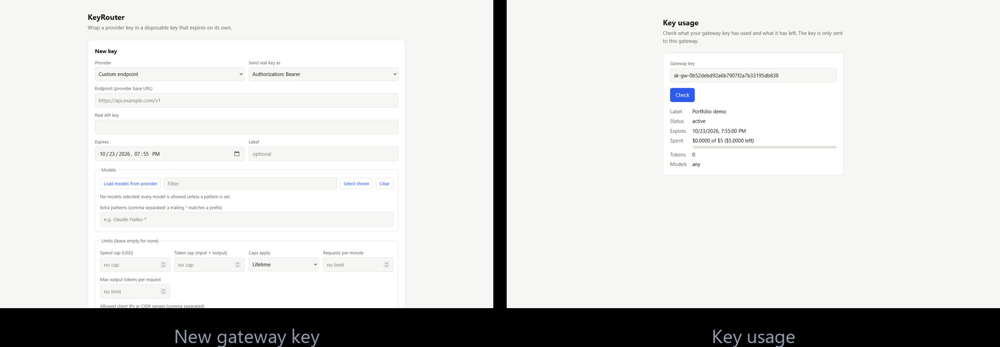

# KeyRouter

A single Cloudflare Worker that hands out disposable API keys for AI providers. You store one real provider key;
the worker gives you gateway keys (`sk-gw-…`) that expire on their own, can be limited, and can be revoked. Clients
call the worker with a gateway key and the worker forwards the request with the real one. Streaming works.

Anthropic, OpenAI, Gemini, Azure OpenAI, OpenRouter, Groq, DeepSeek, Mistral, xAI and anything else with an OpenAI- or
Anthropic-shaped API. It runs on the Cloudflare free plan.

You install it, then own it: one owner account, no operator, nothing phones home.

<a href="screenshots/showcase.jpg"></a>

## What a gateway key can do

- Expire at a set time. The real key is erased from storage at expiry.
- Allow only chosen models, loaded from the provider's own list.
- Cap spend in USD and tokens, over its lifetime or per calendar month.
- Switch new requests to a cheaper model after a share of its cap is used.
- Limit requests per minute and output tokens per request.
- Work only from given IP ranges, or only during given days and hours.
- Call a webhook once per period when it crosses a percentage of its cap.

The admin page tracks spend and cost per key, reports per day and per week, flags a key whose hour costs five times its
usual, exports everything as JSON or CSV, and hands a key over through a one-time link. Key holders see their own
budget at `/usage`: spend and token bars, what is left, when a monthly key resets, what each model cost, and a button
to ask for a replacement key.

## Deploy

You need a free [Cloudflare account](https://dash.cloudflare.com/sign-up), [Node.js](https://nodejs.org) 22.15+ and Git.

```sh
git clone https://github.com/Yash-Awasthi/KeyRouter.git
cd KeyRouter
npm run setup
```

`setup` signs you in to Cloudflare, deploys the worker and asks for two secrets:

- `ADMIN_PASSWORD` protects the admin page until you add a passkey.
- `ENCRYPTION_KEY` encrypts the real provider keys in storage. Use a long random value such as
  `openssl rand -hex 32` and keep a copy: stored keys cannot be read without it.

Optional, each with `npx wrangler secret put <NAME>`:

| Secret | Effect |
|---|---|
| `VIEWER_PASSWORD` | a second, read-only account; every write route answers 403 |
| `ALERT_WEBHOOK` | POSTs on a cap threshold, on an anomalous hour, and once a day with the usage digest |
| `REQUEST_LOG=true` | keeps one line per call (key prefix, model, status, tokens, cost, latency) for seven days |
| `ALLOW_QUERY_KEY=true` | accepts `?key=` for Gemini clients that cannot send a header. URLs leak; prefer `x-goog-api-key` |
| `ALLOW_PASSWORD=true` | the recovery path when every passkey is lost; the only way to run password-only |
| `ALLOW_LOCAL_BASE=true` | local `wrangler dev` only, so a key can point at a stub on `127.0.0.1`. Never set it on a deployment |

Open `https://ai-gateway.<your-subdomain>.workers.dev/admin` and sign in with any username and the password. A new
deployment can take a minute to answer.

Sign-in is throttled: five wrong attempts from one address within 15 minutes block that address for 15 minutes,
doubling up to a day on repeat. Still use a long random password.

## Create a key

1. Pick a provider preset, or enter a base URL as the provider's docs give it (`https://api.example.com/v1`) and choose
   the header and scheme it expects. The URL must be `https`; private, loopback, link-local and metadata addresses are
   refused, so a gateway key cannot become a probe of the worker's own network.
2. Enter the real key and an expiry, then optionally load the provider's model list, tick what to allow, and set limits.
3. Create it. Up to 20 keys can be made at once with the same settings.

Each row has Edit, Duplicate (reuses the real key), Share link, Reset usage and Revoke. Revoking wipes the stored real
key at once and keeps the record with its spend. KV is eventually consistent, so a location that has not refreshed can
keep honouring an old record for up to 60 seconds. A share link reveals the key once, after a button press, and lasts
24 hours or until the key expires. Deleting a key removes the entry and its usage.

### From a terminal

```sh
KEYROUTER_URL=https://gw.example KEYROUTER_PASSWORD=... npx keyrouter create --provider openai --key sk-... --cap 20 --days 7
```

`--provider` picks the base URL (openai, anthropic, openrouter, gemini, groq, deepseek) or `--base` names one; `--url`,
`--password` and `--key` fall back to `KEYROUTER_URL`, `KEYROUTER_PASSWORD` and `KEYROUTER_PROVIDER_KEY`. `--json` prints
the worker's answer verbatim. The CLI signs in with the admin password, so on a passkey-only deployment it is refused
and says why.

### Azure and Bedrock

Two providers need more than a base URL, and both are set on the key:

- **Azure OpenAI** — add `"azure": { "deployment": "gpt5-prod", "apiVersion": "2024-10-21" }` and point `base` at the
  resource (`https://res.openai.azure.com`). The gateway builds `/openai/deployments/<deployment>/…?api-version=…`, so
  a client cannot move the call to another deployment.
- **Bedrock** — every call is signed with SigV4. Add `"aws": { "region": "us-west-2", "accessKeyId": "AKIA…" }` and
  store the AWS **secret access key** as the provider key; `base` must be an `amazonaws.com` endpoint.

A signing style paired with the wrong host is refused at creation, because an AWS signature sent to OpenAI would be a
secret in the clear. The admin page probes each provider host at most once a minute and shows a **Provider down** banner
when one stops answering; `GET /admin/health?refresh=1` asks again.

## Use a key

Point an OpenAI-style client at `https://<worker>/v1` with the gateway key in place of the real one. The key is accepted
as `Authorization: Bearer`, `x-api-key`, `api-key` or `x-goog-api-key`. A key in the query string is refused with 400.

Claude Code, with a provider that has an Anthropic-compatible API, goes in `~/.claude/settings.json`:

```json
{
  "env": {
    "ANTHROPIC_API_KEY": "<gateway key>",
    "ANTHROPIC_BASE_URL": "https://<worker>",
    "CLAUDE_CODE_DISABLE_NONESSENTIAL_TRAFFIC": "1"
  }
}
```

| Status | Meaning |
|---|---|
| 401 | Unknown, revoked or expired key |
| 403 | Model not allowed, wrong address, outside the time window, or an unmeterable path on a capped key |
| 429 | Spend cap, token cap or rate limit reached |
| 502 | Provider unreachable or failed; nothing was counted |
| 503 | The meter is unavailable, so the call is refused rather than admitted uncounted |

A rerouted request's response carries `x-gateway-downgrade`, for example `claude-opus-5-5 -> claude-sonnet-5-5`.

## Costs

Calls to `/v1/messages`, `/v1/chat/completions`, `/v1/responses`, `/v1/completions`, `/v1/embeddings` and Gemini's
`generateContent` are metered from the provider's own token counts. Every other POST path — audio, images, batches,
files — is refused for a capped key, because a cap that silently does not apply is worse than none.

Prices are USD per million tokens, edited in the admin page, and default to Anthropic's list prices. A row matches any
model whose name contains it and the longest match wins; a cost the provider reports itself (OpenRouter) is used
directly; a model with no price is counted in tokens only, so give it a token cap or leave it off the allowlist. Set a
credit limit with the provider as well.

Spend is stored as an integer count of 1e-9 USD so totals cannot drift, and each usage row records the price version
that charged it, so editing the table never rewrites history. Caps are checked before each request, and each call in
flight reserves its average cost, so a burst cannot all pass the same check; the worst case is one request going over.

## Admin

No key can be created until you add a passkey, and the page warns you until you do. Under Sign-in add a passkey
(fingerprint, face, phone or security key); from then on the password stops working and a session lasts 12 hours. Add
two, since a passkey only works on the address it was created on. If every passkey is lost, set `ALLOW_PASSWORD=true`,
sign in with the password, add a passkey, then delete the secret.

There is one owner. Invites (`POST /admin/invites`, 24 hours) give **viewers** read-only access through a passkey they
register themselves at `/join?code=…`; every write answers 403 and the page hides the controls they cannot use. Every
change is written to an append-only audit log, readable in the page or as `GET /admin/audit.csv`.

Also in the page: a Prices table that is editable at runtime, a Host budgets card that caps the total spend of every key
on one provider host, a Report card for today, 7 or 30 days, a Rotation requests card, and a Recent requests card when
the log is on. `GET /admin/export` dumps every record sealed and every usage row; `GET /status` and `GET /metrics` are
for an external monitor. `/status` reports when the deployment happened when you set the optional `BUILD` var to
`<iso date>:<sha>`; without it the time is honestly reported as unknown.

## Free plan limits

| Resource | Free allowance per day | Used by |
|---|---|---|
| Worker requests | 100,000 | every call |
| KV reads | 100,000 | every call |
| KV writes | 1,000 | creating or editing a key, expiry, saving the price table |
| Durable Object requests | 100,000 | metered calls, and calls on keys with caps or rate limits |

A created or edited key costs one KV write, so about 1,000 keys a day; the expiry that wipes a real key is another. When
the quota is reached, creating a key answers 503 naming the limit and the reset time instead of a bare 500, and a batch
stops at the first refused write with `x-keys-created` saying how many were stored.

A request may make 50 subrequests, so the page lists and creates keys 20 at a time and search pages through the matches.
Metering stays inside the 10 ms CPU limit, which `wrangler.jsonc` states (`limits.cpu_ms: 10`) rather than assumes. The
key list comes from KV metadata, capped at 1024 bytes, so a key with many addresses shows a shortened limits string;
opening it shows the full settings.

## Maintenance

| Task | Command |
|---|---|
| Update | `git pull`, then `npm run deploy` |
| Change a secret | `npx wrangler secret put ADMIN_PASSWORD` (or `ENCRYPTION_KEY`) |
| Export everything | `curl -u "admin:$ADMIN_PASSWORD" "$URL/admin/export" > dump.json` |
| Restore | `node scripts/restore.mjs dump.json` (needs wrangler and the same `ENCRYPTION_KEY`; add `--dry-run` to print the writes first, `--namespace-id` when the KV id is not in `wrangler.jsonc`) |
| Remove everything | `npx wrangler delete`, then delete the KV namespace in the dashboard |

Changing `ENCRYPTION_KEY` by hand makes existing keys unreadable. To change it without touching any key, re-seal first,
then set the secret:

```sh
curl -u "admin:$ADMIN_PASSWORD" -X POST "$URL/admin/reseal" -H 'content-type: application/json' -d '{"to":"the-new-long-passphrase"}'
# {"resealed":12,"skipped":0,"failed":[],"total":12}
npx wrangler secret put ENCRYPTION_KEY   # paste the same new passphrase
```

`from` defaults to the current `ENCRYPTION_KEY`. Every row is opened with the old passphrase, sealed with the new one and
opened again before it is written, so a wrong passphrase reports a `failed` list and changes nothing.

## Security notes

- Real keys are encrypted with AES-GCM, bound to their gateway key, and never sent to the browser.
- Client IP headers, cookies, origin, referer and the gateway key are stripped before forwarding; redirects from a
  provider are handed back rather than followed.
- The admin API only accepts JSON, which another site cannot send with your session cookie, and the cookie is
  `HttpOnly; Secure; SameSite=Strict`.
- Every page is served under a strict CSP (no inline code, or a per-response nonce) with HSTS, `nosniff` and a
  `Permissions-Policy` that refuses the camera, microphone and location.
- What is stored: encrypted provider keys, hashed addresses in the throttle, key labels, usage totals and — only with
  `REQUEST_LOG=true` — one line per call. No prompt or completion content is ever stored.

## Layout

`worker.js` is the router and nothing else; it exports the two Durable Object classes the runtime needs to find.

| File | Holds |
|---|---|
| `src/proxy.js` | the proxy, the key holder's usage page, share links, key parsing, header stripping |
| `src/admin.js` | the admin API: keys, prices, passkeys, invites, budgets, reports, export, `/status`, `/metrics` |
| `src/auth.js` | the `Admin` Durable Object: passkeys, sessions, the sign-in throttle, audit log, health probe |
| `src/meter.js` | the `Meter` Durable Object: usage extraction, stream metering, caps, per-day and per-hour buckets |
| `src/pricing.js` | the price table, `cost()` and the OpenRouter import |
| `src/net.js` | IP/CIDR rules, weekly time windows, the base-URL (SSRF) guard |
| `src/sigv4.js` | AWS SigV4 signing for Bedrock |
| `src/crypto.js` | sealing and unsealing real keys |
| `src/http.js` | response helpers |
| `src/pages.js` | the five pages, their headers and CSP |
| `src/log.js` | the opt-in request log ring |

The admin page is three files: `admin.html` is a shell that names `/admin/admin.css` and `/admin/admin.js`, both served
from `pages/` as text modules (the `.txt` suffix keeps tsc out of browser code). The other pages keep one inline block
each and are served with a per-response nonce stamped onto every `<script>` and `<style>`.

## Development

```sh
npm run check     # lint, types and tests — the three gates CI runs
npm test          # 146 tests, no runtime dependencies
npx wrangler dev  # local worker; ADMIN_PASSWORD and ENCRYPTION_KEY go in .dev.vars
npm run smoke     # create → call → usage → revoke against a stub provider
```

`.nvmrc` pins Node 24 and `engines` states the 22.15 floor. CI runs the lint, the type check and the tests on 22.15 and
24, then bundles the worker with `wrangler deploy --dry-run`, so a broken `wrangler.jsonc` or a Durable Object
migration cannot reach `master`. `test/units.test.js` covers the pure parts (stream metering, address and time rules,
prices, SigV4), `test/tooling.test.mjs` the CLI, the restore script and the smoke journey, and anything that goes
through a route lives in `worker.test.js`. `npm run lint` also runs `scripts/lint_pages.mjs`, which fails if a page
assigns raw HTML, if a control has no label, or if an error line is not announced.

## License

MIT
